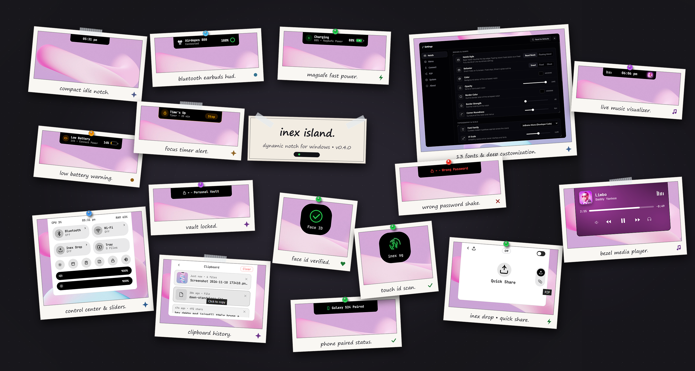
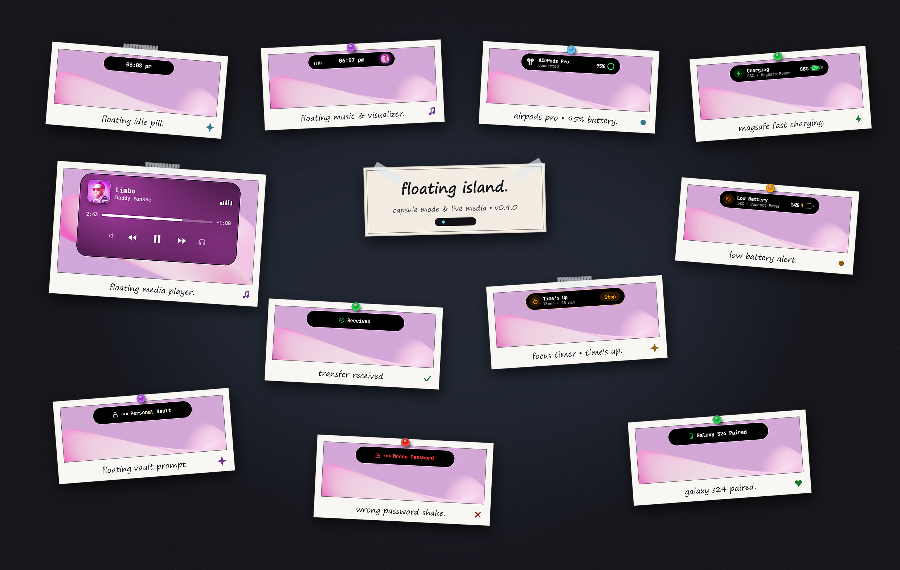

<div align="center">

# Inex Island 🏝️

**A Dynamic Island and control center for Windows 10 & 11.**
Built with Tauri 2 and Rust.


<br/>

### Bezel Notch & Interface Overview


### Floating Island Mode


</div>

---

## Features

- **Mac Menu option**: new features with seamless control center subviews and sleek navigation.
- **Island or notch**: sits flush with the top bezel, or floats as a pill. Hides itself in fullscreen apps and games.
- **Inex Drop**: send and receive files with Android and Windows Quick Share (Nearby protocol written in Rust, no phone app needed), or use P2P Link between PCs.
- **Media**: shows what is playing from any app, with a 5-band audio visualizer and one-click audio output switching.
- **Timer, alarms and calendar**: focus timer with presets, daily or one-time alarms with snooze, and a monthly calendar.
- **Alerts**: charging, low battery, Bluetooth connect and file transfer popups.
- **Quick tools**: clipboard history (text, images, files), quick notes, screenshot snip, keep-awake, lock PC and calculator.
- **Controls**: volume, brightness, Wi-Fi and Bluetooth lists with battery levels.
- **Live widgets**: weather, CPU, RAM, GPU, disk, battery and network speed. Weather uses Open-Meteo and finds your location automatically, or you can set a city in Settings.
- **Inex Locker**: shows unlock prompts from the Inex App Locker / Folder Locker.
- **Look**: 13 fonts, UI scale 80–140%, your own colors, glass blur and corner roundness.

---

## Tech stack

| Part | What it uses |
| --- | --- |
| Backend | Rust, Tauri 2, `windows-rs`, `rustfft`, `wmi` |
| Frontend | Plain JavaScript and CSS in WebView2 (source in `main-parts/`) |
| File transfer | Quick Share (Rust), WebRTC data channels for P2P |
| Signaling | None. P2P Link uses two short copy-paste codes (no server) |

Windows features (audio, Wi-Fi, Bluetooth, registry, media) use native Windows APIs directly, with no helper processes like PowerShell or `netsh`.

---

## Build

You need [Node.js](https://nodejs.org/) 18+, [Rust](https://rustup.rs/) (stable) and the Visual Studio C++ Build Tools with the Windows SDK.

```bash
git clone https://github.com/inrwxyz/inex-island.git
cd inex-island
npm install
npm run dev      # run in development
npm run build    # installer ends up in src-tauri/target/release/bundle/nsis/
```

> `src/main.js` is generated from `main-parts/*.js` on every build. Edit the parts, not the generated file.

---

## P2P Link (no server)

P2P Link connects two PCs directly. Nothing runs until you press **Generate** or paste a code.

1. PC A: open the menu, **Inex Drop**, then the P2P icon on the right rail, and press **Generate**. Click the code to copy it and send it to PC B.
2. PC B: paste (or drop) the code in the box. A reply code is made and copied. Send it back to PC A.
3. PC A: paste (or drop) the reply code in the same box. The link opens.

Each code is valid for 3 minutes and stops working as soon as the link is up.

---

## License

GPL-3.0-or-later. See [LICENSE](LICENSE).

Created by [@inrwxyz](https://github.com/inrwxyz).
