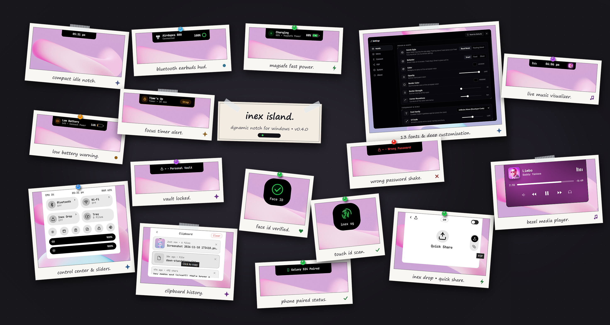
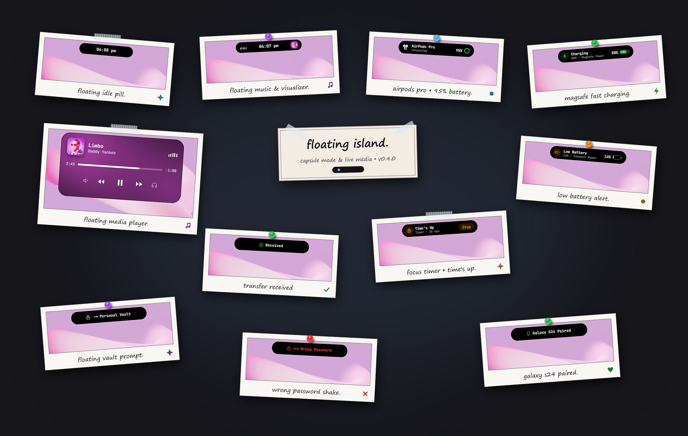

<div align="center">

# Inex Island 🏝️

**A Dynamic Island and control center for Windows 10 & 11.**  
Built with Tauri 2 and Rust.


<br/>

### Bezel Notch & Interface Overview


### Floating Island Mode


</div>

---

## Features

### The Island (Notch)

- Three display styles: **Bezel** (flat notch on screen top), **Curved** (smooth concave curved ears), and **Floating** (standalone capsule pill below the top edge).
- Three window modes: **Smart** (auto-hides in fullscreen apps and games), **Fixed** (stays visible), and **Ghost** (subtle transparent outline).
- Resting pill content: Clock, Weather, CPU %, RAM %, Battery %, Companion Pet, or an automatic cycle timer.
- Hover expansion widgets: Stretching the pill on hover reveals customizable left and right widgets (Weather, CPU, RAM, GPU, Battery, Disk, or Network speed).
- Microphone privacy indicator: Displays a dot next to the clock whenever any application records audio via Windows Core Audio sessions.
- Appearance customization: Island background color picker, opacity slider, 13 custom font pairings, and UI zoom scaling (100% to 140%).
- Notch media expansion: Clicking the music pill expands into a dedicated media player with dynamic contrast colors, album ambient wave glow, progress seek bar, 5-band visualizer, audio device selector, and a capsule volume slider.
- Focus timer countdown: Shows active timer countdown with an hourglass indicator directly on the pill.

### Pop-ups & System HUDs

- Power & battery alerts: Charger connected / disconnected status, live charging percentage, and customizable low-battery warnings.
- Bluetooth HUD: Device connection alerts with live battery level rings.
- Clipboard toast: Subtle "Copied" alert on clipboard text changes.
- Biometric & lock screen animation: Scanning card animation that transitions into an "Unlocked" check on Windows session unlock.
- File transfer toasts: Incoming file notifications, progress tracking, and transfer complete confirmations.
- Wellness reminders: Water, eye-rest, and posture stretch reminder alerts.
- Configurable sound effects: Individual audio toggle switches for power, Bluetooth, file transfer, and lock states.

### Control Menus

Two distinct layouts, switchable from Settings:

- **Classic Menu**:
  - Wireless tiles: Wi-Fi, Bluetooth, Inex Drop, and File Tray.
  - Smooth volume and brightness slider bars with hardware sync.
  - Audio output device switcher menu.
  - Configurable 7-slot quick action bar (Keep Awake, Mic Mute, Snip Tool, Calendar, Focus Timer, Clipboard, Lock PC, Settings, Calculator, Restart, Quick Notes).

- **Control Deck**:
  - Top header strip with system clock, weather status, battery gauge, and widget toggle.
  - **Spotlight Search**: Fast web and URL search box with automatic local browser detection (Chrome, Edge, Firefox, Brave, Opera, Vivaldi), keyboard arrow navigation, and persistent browser selection.
  - System performance card: CPU and RAM load rings, battery state, and disk space usage.
  - Action tiles and sliders for network, Bluetooth, P2P transfer, volume, and brightness.
  - Multi-tab **Widgets Deck**: Screen Time tracking overview, interactive world clock, speed test tool, notepad, and prayer times.

### Media & Audio

- Windows Media Integration: Reads title, artist, playback status, duration, and album art from active media sessions (Spotify, browsers, media players).
- 5-band audio spectrum visualizer (60 Hz to 16 kHz) powered by native FFT sampling of system audio output.
- Real-time volume and mute synchronization across Windows audio sessions.
- Audio output switcher: Fast switching between default playback devices.
- Hardware brightness control via WMI, matching Windows Fn keys and action center sliders.

### Connectivity & File Transfer

- **Inex Drop (Quick Share)**: Native Rust implementation of Google Nearby / Quick Share protocols using mDNS discovery, Bluetooth LE beacons, and encrypted peer-to-peer Wi-Fi channels. Compatible with Android and Windows Quick Share without third-party phone utilities.
- **P2P Link**: Direct PC-to-PC WebRTC encrypted data channel connection. Establishes serverless connections using QR image exchange or one-time text codes.
- **File Tray**: Drag-and-drop file parking shelf on the island. Retains absolute file paths without duplication, enabling drag-out to desktop, file explorer, or apps. Includes color-coded file type icons (`.fico`) with extension badges for documents, media, archives, and code.

### Screen Time & Analytics

- Local disk-backed Screen Time tracking engine in Rust.
- Tracks active foreground application usage with 30-day rolling history and automatic pruning.
- Master toggle switch in Settings to disable/enable tracking at any time without data loss.
- Summary display in Settings and Control Deck widgets.

---

## Tech Stack

| Component | Technologies |
| --- | --- |
| **Backend** | Rust (2021 edition), Tauri 2, Windows API (`windows` crate: Core Audio, WLAN, Bluetooth, WinRT Media, Shell, Registry), `wmi`, `rustfft`, `tokio` |
| **Quick Share** | `prost` (Protobuf), `p256`, `hkdf`, `aes`, `hmac`, `mdns-sd`, `socket2`, BLE advertisement |
| **Frontend** | Vanilla JavaScript (ES Modules), modular CSS, WebView2 runtime (zero third-party web frameworks) |
| **File Transfer** | Quick Share (Rust), WebRTC data channels for P2P Link |
| **Signaling** | Fully serverless. Handshake via QR code scanning or 6-digit text exchange |
| **Packaging** | WiX Toolset (`.msi`) and NSIS (`.exe`) installers |

Minimum system requirement: Windows 10 (version 1903+) or Windows 11 with WebView2 Runtime.

---

## Project Structure

```
inex-island/
├── main-parts/         Modular entry scripts, concatenated into src/main.js
├── styles-parts/       Modular CSS sheets, concatenated into src/styles.css
├── scripts/            Automated assembly scripts (build-styles.mjs, build-main.mjs)
├── src/
│   ├── js/
│   │   ├── core/       DOM utilities, state bus, Tauri bridge, view switcher, settings sync
│   │   └── features/   Feature modules (spotlight, media, tray, controls, widgets, etc.)
│   ├── index.html      Island, Control Deck, and Notch markup
│   ├── settings.html   Standalone Settings application window
│   ├── settings.js     Settings business logic and layout blueprints
│   ├── shared.js       Theme computation, defaults, and cross-window state
│   └── styles.css      Generated stylesheet
└── src-tauri/
    ├── src/
    │   ├── main.rs     Tauri setup, command dispatch, window management, system tray
    │   ├── audio.rs    Core Audio session endpoints and device switcher
    │   ├── bluetooth.rs Native Windows Bluetooth LE discovery and battery polling
    │   ├── brightness.rs WMI brightness controller
    │   ├── clipboard.rs Clipboard history watcher and file reader
    │   ├── live.rs     System event listeners (power, session lock, media)
    │   ├── screentime.rs Local foreground process monitor and rolling history
    │   ├── spotlight.rs Installed browser detection and browser-specific URL launcher
    │   ├── visualizer.rs System output capture and 5-band FFT pipeline
    │   ├── wifi.rs     WLAN scanning and profile management
    │   └── quick_share/ Google Nearby protocol implementation
    ├── Cargo.toml
    └── tauri.conf.json
```

---

## Building from Source

### Prerequisites
- [Node.js](https://nodejs.org/) (v18 or v20 LTS)
- [Rust](https://rustup.rs/) (stable channel, 1.75+)
- Visual Studio C++ Build Tools with the Windows 10/11 SDK

### Build Commands

```bash
# Clone the repository
git clone https://github.com/inrwxyz/inex-island.git
cd inex-island

# Install build dependencies
npm install

# Run in live development mode
npm run dev

# Regenerate joined CSS and JS scripts
npm run build:parts

# Compile release binaries and installers (.exe and .msi)
npm run build
```

The compiled release installers are generated in:
- `src-tauri/target/release/bundle/nsis/Inex Island_1.0.0_x64-setup.exe`
- `src-tauri/target/release/bundle/msi/Inex Island_1.0.0_x64_en-US.msi`

---

## License

GNU General Public License v3.0 (GPL-3.0-or-later). See [LICENSE](LICENSE) for details.

Developed by [@inrwxyz](https://github.com/inrwxyz).
